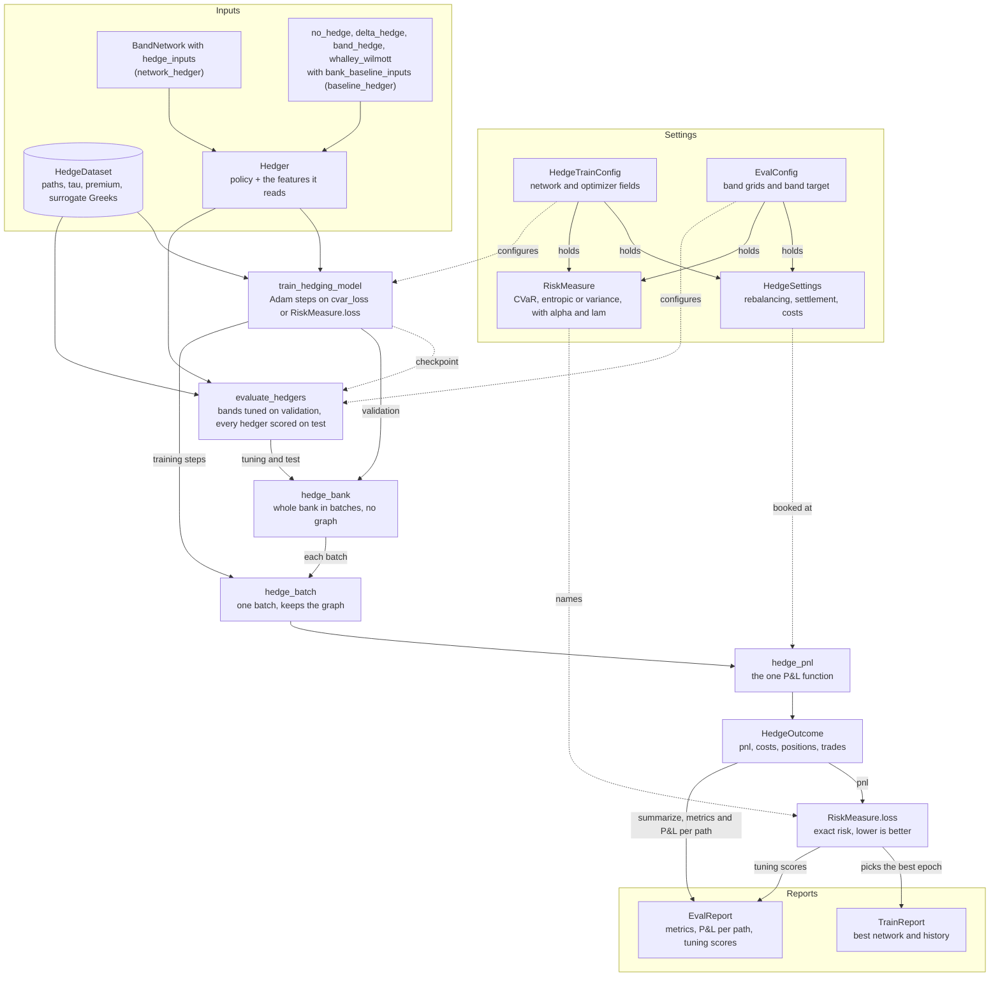

# The Deep Hedging model

This page explains the Deep Hedging model built in this project: what it does, how it is built, and the choices I made along the way, each with its motivation. The measured results, from the checks that pin each part to the evaluations of the hedgers, are on their own page, [hedging-results.md](hedging-results.md).

**What it does.** The model hedges a short American put. The hedger sells the put at the price given by the project's neural surrogate (`PutSurrogate`), then trades the stock once a day until the holder exercises or the put expires. A neural network chooses the stock position on each day. It does not output the position directly. It outputs a no-trade band around the surrogate's delta (Imaki et al. 2021), so it starts as the delta hedge and learns when a trade is not worth its cost. The aim is a hedge that stays safe when trading costs money, where rebalancing to delta every day spends most of the premium.

**How it learns.** The network is trained by Deep Hedging (Buehler, Gonon, Teichmann and Wood, 2019). Thousands of price paths are simulated, and one differentiable function books the hedge's final profit and loss (P&L) on each. Gradient descent then lowers a risk measure of those P&Ls, by default the conditional value at risk (CVaR) at 95%, the mean loss on the worst 5% of paths. The P&L is a known formula of the positions, so its gradient is exact, and the network is trained on the very number it is judged by.

**How it is built.** The pipeline has three steps, each run by its own command. `python -m optionpricing.ml.hedging.generate_hedge_dataset` simulates a bank of scenarios: paths, contracts, premiums, the surrogate's Greeks and the day each holder exercises. `python main.py train-hedge` trains the network on one bank and keeps its best epoch on another. `python main.py test-hedge` scores it on a third bank, next to analytic baselines (no hedge, delta, a fixed band and the Whalley-Wilmott band).

**Where it comes from.** The project's first hedger was a reinforcement-learning agent, Soft Actor-Critic (SAC). Its environment booked each hedge one day late ([B-037](../../.claude/BUGS.md#b-037-hedgingenv-applies-each-hedge-one-step-late)) and had no cash account ([B-038](../../.claude/BUGS.md#b-038-hedging-pl-has-no-cash-account-so-the-delta-baseline-hedges-the-wrong-liability)). Its exercise dates came from a rule fitted on the same paths it was tested on. Rather than patch it, I rebuilt the hedger on a correct P&L. SAC is kept as `train-hedge-legacy` and `test-hedge-legacy` for one later comparison.

**Status.** Everything on this page is built and runs through the commands above. The network is not trained on the full banks yet, so [hedging-results.md](hedging-results.md) holds checks and baselines so far. The work is planned in [`.claude/PLAN.md`, Hedging rebuild](../../.claude/PLAN.md#hedging-rebuild).

**Units.** Positions are in shares per option. Prices and P&L are per option at $`K`$ = 100, in dollars. Costs use a proportional rate $`\varepsilon`$ (1% means 1 cent per dollar traded) and a fixed fee $`f`$ per trade.

Each section below gives one choice: what was chosen, what it implies, and why.

## Contents

| Section | In short |
|---|---|
| [Deep Hedging instead of SAC](#deep-hedging-instead-of-sac) | The network is trained on the exact gradient of the risk it is judged by, with no critic and no reward shaping. |
| [One P&L function](#one-pl-function) | One discounted, differentiable function books every hedge, for training, testing and every baseline. |
| [The band network](#the-band-network) | The output is a no-trade band around delta. It holds still exactly and starts as the delta hedge. |
| [The inputs](#the-inputs) | Seven features of the path and the position, plus an optional distance to the exercise boundary. |
| [The exercise boundary](#the-exercise-boundary) | The holder exercises at the tree's boundary, one tree per contract, checked once a day. Its errors cost far less than the P&L's noise. |
| [The fixed fee: straight-through](#the-fixed-fee-straight-through) | The P&L charges the exact fee, and the gradient uses a smooth look-alike. |
| [The building blocks](#the-building-blocks) | Risk measures, costs and settlement each live in one file, shared by training and testing. CVaR at 95% is the default. |
| [The pipeline](#the-pipeline) | Dataset, training and testing are three steps, so one bank serves many experiments. |
| [How the pieces fit](#how-the-pieces-fit) | The types and functions of the pipeline, as a diagram. |
| [The defaults](#the-defaults) | A narrow contract family, daily rebalancing, cash settlement. The other settings are set by checks. |
| [Results, on their own page](hedging-results.md) | The checks that pin each part, and the evaluations of the hedgers. |

## Deep Hedging instead of SAC

The hedger is a neural network trained by Deep Hedging. A risk measure of the terminal P&L, computed over a batch of simulated paths, is minimized directly by gradient descent.

SAC learns differently. It treats the P&L as a black box and estimates its gradient with a second network, the critic, and with random exploration. It also optimizes a daily reward $`x - \lambda x^2`$, which only matches the variance of the final P&L when each daily reward has zero mean, and without a cash account it doesn't. Here the P&L is a known formula. Backpropagation through the whole path gives its exact gradient, so there is no critic, no exploration and no reward shaping, and the objective is the metric the hedger is judged on.

Two things follow. No labels are needed, since training lowers a score of the batch rather than an error against a target. And that score is a property of the whole batch. CVaR is the average of the worst 5% of paths, so a batch must be large for its tail to hold enough paths, about 4096 of them.

## One P&L function

One differentiable torch function books the P&L in today's dollars:

```math
\large \mathrm{PL} = p_0 + \sum_k \delta_k \big(\tilde S_{k+1} - \tilde S_k\big) - \sum_k \tilde c_k - \tilde Z
```

Here $`p_0`$ is the premium received at $`t_0`$. $`\tilde S_k = e^{-r t_k} S_k`$ is the discounted share price, which is how cash earns the rate $`r`$. The position $`\delta_k`$ is chosen at $`t_k`$ and earns over $`[t_k, t_{k+1}]`$. $`\tilde c_k`$ is the discounted cost of the trade at $`t_k`$, the opening trade included. $`\tilde Z`$ is the discounted settlement at exercise or expiry: the payoff owed to the holder plus the cost of closing the share position.

The function takes any policy with one interface, inputs in and a position out. The network, every baseline, training and testing all call it, through `hedge_batch` and `hedge_bank` ([How the pieces fit](#how-the-pieces-fit)).

**Why one function.** The SAC environment got two terms wrong. It paid the gain over $`[t_k, t_{k+1}]`$ to the position chosen at $`t_{k-1}`$ ([B-037](../../.claude/BUGS.md#b-037-hedgingenv-applies-each-hedge-one-step-late)), and it had no premium and no cash account ([B-038](../../.claude/BUGS.md#b-038-hedging-pl-has-no-cash-account-so-the-delta-baseline-hedges-the-wrong-liability)). The lag survived because the accounting existed twice, in `HedgingEnv.step` and in `rollout_pnl`, and the copy kept the bug. With one function, a baseline and the network cannot be booked differently.

## The band network

The network outputs two numbers per day, $`a_k`$ and $`b_k`$. They become a band around the surrogate delta $`\Delta_k`$, and the position is yesterday's, moved just enough to stay inside it:

```math
\large l_k = -\operatorname{softplus}(a_k) \le 0, \qquad u_k = \operatorname{softplus}(b_k) \ge 0
```

```math
\large \delta_k = \operatorname{clamp}\big(\delta_{k-1},\ \Delta_k + l_k,\ \Delta_k + u_k\big)
```

This is the no-transaction band network of Imaki et al. (2021). I chose it for three properties.
- **It holds still exactly.** Inside the band the position is exactly yesterday's, so no cost is paid. Not being able to hold still was the SAC policy's main failure under costs ([B-010](../../.claude/BUGS.md#b-010-rl-policy-under-trading-costs-keeps-trading-every-day-a-simple-band-beats-it)).
- **It starts as the delta hedge.** With $`a`$ and $`b`$ started very negative, the band is tiny and the clamp returns $`\Delta_k`$ to within it. Training starts from a good strategy.
- **The band can change shape.** It can be wide where gamma is small, narrow near the strike close to expiry, and asymmetric if that helps. A fixed band can't.

**How it starts.** The output layer starts with zero weights and a bias of `init_logit` = −5 on both outputs. So the untrained band has the same half-width everywhere, $`\operatorname{softplus}(-5)`$ = 0.0067 shares, which is the delta hedge to within a few thousandths of a share. The network standardizes its features with the training bank's mean and standard deviation, and stores them, so a saved network reads raw features on any bank. The untrained network is scored on validation as epoch 0, and training returns the best epoch. So it never returns a network that hedges worse than delta on validation (`optionpricing/ml/hedging/hedge_training.py`).

## The inputs

On day $`k`$ the network sees seven features: $`\ln(S_k/K)`$, the time left $`T - t_k`$, $`\sigma`$, $`r`$, the surrogate's $`\Delta_k`$ and $`\Gamma_k`$, and its own previous position $`\delta_{k-1}`$. An optional 8th input, the distance to the exercise boundary $`\ln\big(S_k / S^*(T - t_k)\big)`$, is switched on by a flag.

All of them except $`\delta_{k-1}`$ depend only on the path, so they are computed once, when the dataset is generated. $`\delta_{k-1}`$ is needed because under costs the best trade depends on the position already held. The boundary input is optional so that an experiment can train with and without it, against an optimal holder and a late one, and measure whether the network learns from it.

## The exercise boundary

The holder exercises the first time $`S_t \le S^*(t)`$, with the boundary $`S^*`$ read from the binomial tree (`exercise_boundary` in `optionpricing/pricing/american/batch_binomial_tree.py`). The holder checks once a day, day 0 included. A put not exercised early ends at expiry, and settlement pays it only if it is in the money.

How the exercise date $`\tau`$ is found stays a choice per dataset, so suboptimal holders can be tested too:

| Method | The holder exercises |
|---|---|
| `tree` | at the tree's boundary, optimally |
| `lsm` | by Longstaff-Schwartz's rule, to compare with the legacy results |
| `never` | never early, so the put is European |
| `late` | at $`(1 - \text{shift})\, S^*`$, a fraction `shift` below the boundary |

One tree per contract gives $`S^*`$ at its levels, and the value on day $`k`$ is read off by linear interpolation in time (`daily_boundary` in `optionpricing/hedging/exercise.py`). Levels are `days / nb_steps` apart, so at 1000 steps the nearest one is at most 0.18 day from a daily date, for contracts up to a year.

**What the boundary is.** A put pays $`K - S`$, so exercising it is only worth considering when the stock is low. At every date there is a price $`S^*(t)`$ below which exercising now beats waiting. It is a price, in dollars, not a time. It rises toward $`K`$ as expiry nears, because waiting is worth less and less. For the default contract ($`T`$ = 1 year, $`r`$ = 5%, $`\sigma`$ = 20%), from a 16,000-step tree:

| Time left | 1 year | 3 months | 1 week | 0 (expiry) |
|---|---|---|---|---|
| $`S^*`$ ($) | 80.94 | 86.84 | 94.57 | 100 |

The exercise date $`\tau`$ of a path is the first day its price is at or below that day's $`S^*`$.

**How the tree finds it.** At each time step the tree lists the prices the stock can reach, from lowest to highest. At each of these nodes it compares two values:
- exercise: the payoff $`K - S`$;
- hold: the discounted average of the option's values one step later.

For a put, exercising wins at the low prices and holding wins at the high ones. So at each step the nodes split into two groups, exercise below and hold above, and the boundary lies between the highest node of the first group and the lowest node of the second. The nodes are 1.3% apart at 1000 steps. So the code places $`S^*`$ where "hold minus exercise" crosses zero, on a straight line between those two nodes. Today's step for the default contract:

| Node price ($) | Hold ($) | Exercise ($) | Hold − exercise ($) |
|---|---|---|---|
| 80.651 | 19.3440 | 19.3487 | −0.0047 |
| 81.678 | 18.3334 | 18.3220 | +0.0114 |

The zero crossing is at $80.95. Deep in the exercise region, hold minus exercise is about −$0.005. Waiting one step there only delays receiving $`K`$, which loses one step of interest, $`K r \Delta t`$ = 100 × 5% × 0.001 year.

**Why one tree per contract is enough.** The decision at a node depends only on its price, the time left, $`r`$ and $`\sigma`$, not on where the tree started. So $`S^*/K`$ depends only on the time left, $`r`$ and $`\sigma`$. One tree per contract then gives the boundary at every one of its steps, for any $`S_0`$, for about the cost of one price.

**Starting the tree at the strike, with extra nodes below.** To price an option the tree starts at today's price $`S_0`$. For the boundary the starting price does not matter, so the tree starts at $`K`$, and the function needs no $`S_0`$. A tree fans out from where it starts. After $`i`$ steps its $`i + 1`$ prices go from $`K u^{-i}`$ to $`K u^{i}`$, with $`u`$ = 1.0063 for the default contract at 1000 steps. Near the start the fan is narrow, about ±6% after 10 steps. The boundary is 19% below $`K`$, so for the first 33 steps no node is low enough to be exercised, and there is no boundary to read.

The fix widens the fan downward. At every step the tree also computes a few more prices below its lowest one, as if it had also started from $`K u^{-2}`$, $`K u^{-4}`$, and so on. This has three consequences:
- every step now has nodes on both sides of the boundary;
- the original nodes keep their values exactly, because a node's value comes only from the nodes it can reach later;
- each step costs one more node update per extra node, about $`N \times`$ `nb_extra_nodes` in total on top of the tree's $`N^2/2`$.

**How many extra nodes.** The count, `nb_extra_nodes` in the code (set by `_nb_extra_nodes`), must be large enough for the lowest starting price to sit below the boundary. The steps below use the default contract: $`K`$ = $100, $`T`$ = 1 year, $`r`$ = 5%, $`\sigma`$ = 20%, $`N`$ = 1000 steps.

**1. How the tree moves.** Each step lasts $`\Delta t = T/N`$ = 0.001 year. In one step the price is multiplied either by $`u`$ (up) or by $`1/u`$ (down), with $`u = e^{\sigma \sqrt{\Delta t}}`$ = $`e^{0.006325}`$ = 1.006345, so ±0.63% per step.

**2. Where the extra prices sit.** At one step, neighbouring prices differ by a factor $`u^2`$, since going from one to the next swaps a down move for an up move. The extra prices must stay on this grid, so that each leads to two prices of the next step by one up or one down move. So the starting step holds

```math
\large K u^{-2n}, \ \ldots, \ K u^{-4}, \ K u^{-2}, \ K
```

and with $`n`$ extra nodes the lowest starting price is $`K u^{-2n}`$.

**3. The floor: the lowest the boundary ever goes.** The boundary itself is what is being computed, so it cannot set $`n`$. A lower bound on it can. An American put with more time left is worth at least as much as one with less, because it can follow any exercise plan the shorter one can, and has more besides. So at every price holding it is worth more, and exercising beats holding only at lower prices. The longer the maturity, the lower the boundary, and the put that never expires (the *perpetual* put) has the lowest boundary of all. That boundary has a closed form (Merton 1973):

```math
\large S^*_\infty = K \, \frac{2r}{2r + \sigma^2} = 100 \times \frac{0.10}{0.10 + 0.04} = 71.43
```

Every finite-maturity boundary lies above it, $80.94 today for the default contract.

**4. The count.** $`n`$ is the smallest whole number with the lowest starting price at or below the floor. Write $`b_\infty = 2r / (2r + \sigma^2)`$ for the floor per unit of strike:

```math
\large K u^{-2n} \le K \, b_\infty \iff n \ge \frac{\ln(1/b_\infty)}{2 \ln u} = \frac{\ln(1/b_\infty)}{2 \sigma \sqrt{\Delta t}}
```

For the default contract, $`\ln(1/0.7143) / (2 \times 0.006325)`$ = 0.3365 / 0.01265 = 26.6, so 27 extra nodes. The lowest starting price is then 100 × $`u^{-54}`$ = $71.07, below the $71.43 floor. Later steps reach lower still, since the fan keeps widening. The code:

```python
perpetual = 2 * r / (2 * r + sigma**2)
return int(np.ceil(np.max(np.log(1 / perpetual) / (2 * sigma * np.sqrt(dt)))))
```

When contracts are priced together they share one array, so `np.max` takes the largest count among them. With $`r \le 0`$ the count is 0, since there is no early exercise to find.

That is enough, because the tree's exercise threshold lies above the exact boundary, which lies above the floor. It was checked on contracts out to $`T`$ = 100 years. For the hedging family the count is at most 125 (at $`T`$ = 3 months, $`\sigma`$ = 30%, $`r`$ = 2%), so the extra work is up to about 25%. A thousand contracts drawn from the family take 3.6 s at 1000 steps.

**Accuracy.** The reference is the price where an 8000-step tree stops exercising today, found by bisection. Errors in dollars at $`K`$ = 100, for the default contract, read along one tree's curve as the hedger reads it:

| Time left | 1 year | 6 months | 3 months | 5 weeks | 1 week | 4 days |
|---|---|---|---|---|---|---|
| Nearest exercise node, 1000 steps | −0.31 | −0.21 | +0.16 | +0.19 | −0.14 | +0.41 |
| Interpolated, 1000 steps | −0.01 | +0.02 | +0.18 | +0.21 | +0.10 | +0.45 |
| Interpolated, 4000 steps | −0.08 | −0.03 | −0.02 | −0.01 | +0.05 | not measured |

- **The interpolation matters most early in the tree.** With a year left it cuts the error from 31 cents to 1.
- **Late in the tree the error grows.** The tree's threshold sits above the exact boundary, by an amount that shrinks with the step size. Late in a one-year tree the steps are those of the year, so the last 3 months get 250 steps instead of the 1000 a 3-month tree would use. Going to 4000 steps cuts the worst error over the first five times from $0.21 to $0.08.
- **The curve wiggles a little.** Neighbouring steps' nodes are offset by one up move, so the curve dips by up to a sixth of the node spacing (about $0.20) from one step to the next, mostly in the last few percent of the maturity.
- **The reference is itself uncertain** by about $0.03. With a year left, the 16,000-step value is 3 cents lower than the 8000-step one.

**On the daily grid, interpolating costs nothing.** Tree levels rarely fall on whole days, so `daily_boundary` interpolates between them. The alternative is a tree whose step count is a multiple of the contract's days, so that every day is a level. That needs one tree call per distinct maturity, since a call shares its step count. Both were compared with a day-aligned tree of about 8000 steps, on 200 contracts of the family (92 to 365 days, 148 distinct maturities, seed 0) with 50 paths each. Errors in dollars at $`K`$ = 100:

| Daily boundary | Max error ($) | Mean error ($) | Paths whose $`\tau`$ differs from the 8000-step tree's | Time (s) |
|---|---|---|---|---|
| Interpolated, 1000 steps | 0.61 | 0.064 | 395 of 10,000 | 1.7 |
| Day-aligned, about 1000 steps | 0.62 | 0.063 | 376 of 10,000 | 8.0 |

The two are equally accurate, because the error comes from the tree's step size and not from the interpolation. Aligning only makes the trees 5 times slower. Both maxima are with 1 day left, where the boundary rises steeply to the strike, the same growth late in the tree as in the table above. About 4% of paths change $`\tau`$ between 1000 and 8000 steps, so more steps is the lever if a check asks for more accuracy, not alignment.

**Why these errors are acceptable.** An error in $`S^*`$ matters through the exercise date it gives each path, and through what a wrong date costs. Both are small.
- **Most paths get the same exercise date.** The holder checks once a day. A path's date changes only if, on some day, its price falls between the tree's $`S^*`$ and the exact one, a band at most $0.45 wide. Most paths never land in it. A path that crosses the boundary in one move lands in it rarely, and is then exercised a day earlier or later. Only a path that drifts along just above the boundary for several days can move by more.
- **A wrong date costs almost nothing.** Inside that band, exercising and holding are worth almost the same. Just above the boundary the put is worth its payoff plus about $`\tfrac{1}{2} \Gamma (S - S^*)^2`$ (smooth pasting). So a trigger off by $`\eta`$ dollars loses at most about $`\tfrac{1}{2} \Gamma \eta^2`$, however many days the date moves. Here $`\Gamma`$ is in shares per dollar. It is about 0.035-0.05 for most of the option's life (3.5-5 per unit of strike), so an error of $0.21 costs about $0.001. With 4 days left $`\Gamma`$ ≈ 0.17 (17 per unit of strike), and the error of $0.45 costs about $0.017.
- **That is far below the noise the experiments measure.** A correctly financed daily delta hedge already has a P&L standard deviation of $0.35 ([B-038](../../.claude/BUGS.md#b-038-hedging-pl-has-no-cash-account-so-the-delta-baseline-hedges-the-wrong-liability)). The worst boundary loss is 20 times smaller.
- **More accuracy is cheap if a check asks for it.** 4000 steps take 0.3 s per contract. The dataset step chooses the number of steps by such a check, like its other settings.

**Why not LSM.** The SAC environment fitted LSM's exercise rule on the same paths it then tested on, so its holder knew the test paths.

## The fixed fee: straight-through

### The problem

A trade of $`x`$ shares at price $`S`$ costs

```math
\large c(x, S) = \varepsilon \lvert x \rvert S + f \, \mathbb{1}[x \neq 0]
```

`loss.backward()` needs the derivative of every step between the weights and the loss, $`\partial c / \partial x`$ included. The proportional part gives $`\varepsilon S \operatorname{sign}(x)`$, a real signal toward smaller trades. The fixed part gives nothing. The indicator $`\mathbb{1}[x \neq 0]`$ is flat everywhere except at 0, where its derivative is a Dirac delta. On a computer that is 0 for every path, and PyTorch treats the comparison `x != 0` as a constant anyway. The network would see the fee in the P&L but get no gradient from it, so it would learn as if the fee did not exist.

### The choice

The forward pass charges the exact fee. The backward pass uses the slope of a smooth look-alike, $`s(x) = 1 - e^{-\lvert x \rvert / \kappa}`$:

```python
hard = (x != 0).float()  # exact step: 0 or 1, no gradient
soft = 1 - torch.exp(-x.abs() / kappa)  # smooth look-alike, has a gradient
indicator = hard + (soft - soft.detach())
cost = eps * x.abs() * S + f * indicator
```

In the forward pass `soft - soft.detach()` is exactly 0, so `indicator` equals `hard` and the fee is exact. In the backward pass `hard` and `soft.detach()` count as constants, so the gradient comes from `soft` alone:

```math
\large \frac{d\,\mathrm{indicator}}{dx} = s'(x) = \frac{\operatorname{sign}(x)}{\kappa} \, e^{-\lvert x \rvert / \kappa}
```

### What the gradient says

With a fixed fee $`f`$ = 0.05 dollars and $`\kappa`$ = 0.01 shares:

| Trade $`x`$ (shares) | Fee charged in the P&L, forward (dollars) | Gradient of the fee, $`f \, s'(x)`$, backward (dollars per share) | What the gradient says |
|--:|--:|--:|---|
| 0.0005 (tiny) | 0.05 | 4.76 | "Shrink this trade, it costs a full fee for almost nothing." |
| 0.02 (small) | 0.05 | 0.68 | "Shrinking it helps a bit." |
| 0.2 (large) | 0.05 | ≈ 0 | "Shrinking it a little won't save the fee, so the fee is no reason to change." |
| 0 (holding) | 0 | 0 | Nothing to save. |

The table lists purchases ($`x > 0`$). A sale of the same size has the same gradient with a minus sign (−4.76, −0.68, ≈ 0), because the fee grows with $`\lvert x \rvert`$, so its slope follows $`\operatorname{sign}(x)`$. Gradient descent steps against the gradient, so both a purchase and a sale are pushed toward a smaller trade.

For scale, the proportional cost at $`\varepsilon`$ = 1% and $`S`$ = 100 has a gradient of 1 dollar per share. The fee pushes hardest on tiny trades, which are the ones a fixed fee makes wasteful.

### Why straight-through

| Option | P&L used in training | Gradient from the fee | Why not chosen |
|---|---|---|---|
| Ignore the fee in training | exact | none | the network learns as if the fee didn't exist |
| Smooth fee, annealed ($`s(x)`$ in the forward pass too, $`\kappa`$ shrunk over training) | undercharges small trades until $`\kappa`$ is small, since $`s(x) < 1`$ | slope of $`s`$ | trains on a P&L that is wrong early on |
| Score-function (REINFORCE) estimator | exact | unbiased but very noisy | brings back the random exploration Deep Hedging avoids |
| Exact boundary term (how the chance of crossing the band edge changes, times $`f`$) | exact | exact | involved to derive and code through a 365-day loop |
| **Straight-through** | **exact** | **slope of $`s`$** | chosen |

Straight-through is the only cheap option that keeps the P&L exact. Its approximation is confined to the direction of improvement.

### What it implies

The gradient is biased. It is the slope of $`s`$, not of the true expected fee. Its direction is right, since a smaller trade is closer to no trade, but its size depends on $`\kappa`$. A small $`\kappa`$ gives strong signals only for very small trades, and a large one pushes on bigger trades too. So $`\kappa`$ is a training setting, tried over a few values.

The fee widens the band through trading days only. On a day the network trades, the clamp puts $`\delta_k`$ on a band edge, and "shrink $`x_k`$" moves that edge toward yesterday's position, which widens the band. Once the trade is exactly 0, the fee and its gradient disappear. Holding days give no fee gradient, which is fine, because no fee was paid.

The reported numbers stay honest. The P&L, the loss value, validation checkpointing and testing all charge the exact fee. A poor $`\kappa`$ can make training less effective, but it can't make the results look better than they are.

## The building blocks

Three small files hold the pieces of a hedge that training, testing and the baselines all use:
- **Risk measures** (`risk.py`): CVaR, the entropic risk and the variance, below.
- **Costs** (`costs.py`): a proportional rate on the dollars traded plus a fixed fee per trade, the fee straight-through as above.
- **Settlement** (`settlement.py`): in cash, the hedger pays $`K - S`$ and closes its $`\delta`$ shares. By delivery, it pays $`K`$ for a share worth $`S`$ and closes the $`\delta + 1`$ shares left. A put exercised before expiry is always in the money, since the boundary lies below the strike. A put that is out of the money at expiry lapses, leaving only the closing trade.

Keeping each in one file means "trained on CVaR" and "scored on CVaR" are the same number, since both steps call the same function. The two settlements give the same P&L before costs and differ only in the cost of closing the position, so the choice is a flag rather than a design fork. Deep in the money a put hedge holds about −1 share. Delivery then closes almost nothing, while cash settlement buys back about one share. So under costs physical settlement is cheaper, exactly on the paths that are exercised.

### The risk measures

A hedging strategy gives one P&L per path, so it is judged by a summary of their distribution. Write $`L = -\mathrm{PL}`$ for the loss. The measures below are losses to minimize, except CVaR as reported, which stays on the P&L scale like every CVaR in the project's results (higher is better).

| Measure | Definition | What it penalizes | Role |
|---|---|---|---|
| CVaR at level $`\alpha`$ | the average of the worst $`1 - \alpha`$ share of P&Ls | only the tail, and how deep it goes | the default objective and the reported metric, at $`\alpha`$ = 95% |
| Entropic risk | $`\frac{1}{\lambda} \ln \mathbb{E}\big[e^{-\lambda \mathrm{PL}}\big]`$ | every loss, more than linearly in its size | an alternative objective, $`\lambda`$ sets the risk aversion |
| Variance | $`\mathbb{E}\big[(\mathrm{PL} - \mathbb{E}[\mathrm{PL}])^2\big]`$ | gains as much as losses | the classic quadratic criterion, kept as a reference |

**CVaR is the default** because it measures what a seller fears, how much is lost in the bad cases. The variance treats a $3 gain as just as bad as a $3 loss. The VaR only says where the bad cases start, not how bad they are. CVaR at 95% is also the level of every earlier result, so the rebuild stays comparable with them.

**CVaR is trained through the Rockafellar-Uryasev form.** "The average of the worst 5%" needs a sort, which gives a poor training signal. Rockafellar and Uryasev (2000) showed that

```math
\large \mathrm{CVaR}_\alpha(L) = \min_w \left\{ w + \frac{\mathbb{E}\big[(L - w)^+\big]}{1 - \alpha} \right\}
```

and that the minimizing $`w`$ is the VaR. So training lowers this expression over the network and $`w`$ together, with no sort. $`w`$ is one extra trainable number with its own, larger learning rate. In earlier experiments outside this repository (not re-run here), $`w`$ on the network's learning rate lagged far behind the true VaR, and the network did no better than delta. The training loop takes the two learning rates separately, so an experiment can check this. $`w`$ starts at the VaR of the untrained network's loss on the first training batch, so it begins near its optimum.

**A fractional tail counts the edge path for its share.** With $`n`$ paths the tail holds $`(1 - \alpha) n`$ of them, which is often not a whole number. Rounding up to a whole number of paths, as the legacy metric did, makes the reported CVaR differ from the minimum of the training form by up to one path's share. Counting the edge path for the fraction inside the tail makes the two equal at every batch size. When the tail is a whole number of paths, as with 2,000 paths at 95%, both definitions give the plain average of the worst ones.

**The entropic risk is the alternative.** It uses every path, so its gradient is less noisy than CVaR's, which comes from about 5% of the batch. But it has no reading as plain as "the average of the worst 5%", so it is not the reported metric. $`e^{-\lambda \mathrm{PL}}`$ overflows on a large loss, so the mean is taken in log space (`logsumexp`).

**The variance is a reference.** It is the quadratic hedging criterion of the textbooks, and its square root is what the earlier results called the hedging error. It is not the default because it penalizes gains.

## The pipeline

The pipeline has three steps, as for the tree surrogate:
1. **Dataset** (`generate_hedge_dataset.py`) simulates the paths, draws one contract per path, and computes the premium (the surrogate's price at $`t_0`$), the surrogate's delta and gamma per day, the boundary and $`\tau`$. It saves them with the metadata that produced them (seeds, ranges, surrogate checkpoint, exercise method).
2. **Training** (`hedge_training.py`, run as `python main.py train-hedge`) trains the band network on a dataset.
3. **Testing** (`hedge_evaluation.py`, run as `python main.py test-hedge`) scores the network and every baseline (no hedge, surrogate delta, a fixed band, the Whalley-Wilmott band) on a test dataset with its own seed.

Every hedger is tested on the same paths, so their differences come from the hedging and not from the draw of paths. The two bands are tuned on a validation dataset, on the risk measure the network is trained on and at the costs they are tested at, so each is the best of its family for that test. `test-hedge` reads the costs and the risk measure from the network's checkpoint. By default the test therefore runs at the training settings, and a flag changes one of them.

| Fixed when the dataset is generated | Chosen at train or test time |
|---|---|
| Paths (daily), contracts, premiums | Rebalancing frequency (weekly dates are a subset of the daily ones) |
| Surrogate delta and gamma per day | Cost rates $`\varepsilon`$ and $`f`$, and $`\kappa`$ |
| Boundary and $`\tau`$, from the chosen method | Settlement, risk measure, $`\alpha`$ or $`\lambda`$ |
| Metadata | Network size, learning rates, the boundary input |

**Why three steps.** Every choice can be changed at its own step without redoing the others. One dataset serves many experiments, and a policy can be tested at costs it wasn't trained on. Computing the surrogate features once matters, because 50,000 paths × 365 days is about 18 million surrogate queries. The last week before expiry is outside the surrogate's domain ($`T`$ ≥ 1 week) and goes to its tree route, which takes most of the generation time. It is paid once ([Dataset checks](hedging-results.md#dataset-checks)).

**Which delta the baselines use.** In the evaluation, every baseline built on delta uses the surrogate's, the one stored in the bank. The tree delta hedge appears only in [Baseline checks](hedging-results.md#baseline-checks), on a small bank. The numbers below are approximate: they size the effects, they are not measurements of this choice.
- **It is the hedger's model.** The band network is centred on the surrogate delta, and the premium is the surrogate's price. With the same delta, a baseline differs from the network only by what the network learned.
- **Its error is far below what the P&L can show.** Against a 4000-step tree, the surrogate's delta is off by about 8.9 × 10⁻⁵ shares on average, and by about 13 × 10⁻⁵ near the money ([surrogate-training.md](surrogate-training.md#the-chosen-model)). That is roughly 6 times the error of its 1000-step teacher, which was measured on other puts and against a 20000-step tree ([surrogate-training.md](surrogate-training.md#choice-of-teacher-bbsr-at-1000-steps)). A one-day move is about $`\sigma \sqrt{1/365}`$ of the price, 1.05% at 20% volatility, so about $1.05 for a $100 stock. An error of 10⁻⁴ shares then costs about $0.0001 a day, next to a daily hedge's own std P&L of about $0.40 ([Dataset checks](hedging-results.md#dataset-checks)).
- **Tree deltas along every path are costly.** The existing banks have a mean exercise day of about 192, so a 10,000-path bank needs about 1.9 million tree prices. If the deltas come from 1000-step trees, at the measured 3 ms per price, that is roughly 1.6 hours, before any batching. The 200-step trees of [Baseline checks](hedging-results.md#baseline-checks) would cost less.

What the surrogate's error costs a hedge can still be measured once, on a small bank, if a later result needs it.

## How the pieces fit

Each idea of the pipeline is one type or one function, and training and testing share them. The diagram reads top to bottom: the settings and the inputs, the two entry points, the booking of a hedge, and the reports.



How to read it, top to bottom:
- **Settings.** `HedgeSettings` says how a hedge is booked: rebalancing, settlement and costs. Its fields are the keyword names of `hedge_pnl`, so it is passed as `**asdict(settings)`. `RiskMeasure` says how a P&L sample is judged. Both are frozen dataclasses that check their own fields.
- **A hedger.** A policy only sees an `inputs` tensor, and the network and the baselines read different features. A `Hedger` pairs a policy with the function that builds its inputs from the bank, so any hedger can be booked on any bank.
- **Booking.** `hedge_batch` hedges a list of scenarios and keeps the autograd graph, for a training step. `hedge_bank` runs `hedge_batch` over the whole bank in batches without a graph, for validation and test. Batches end on different days, so it pads each batch's positions with each path's last position, which is the position it holds after $`\tau`$ anyway. Both go through `hedge_pnl`, the only place the accounting lives ([One P&L function](#one-pl-function)).
- **The outcome.** `HedgeOutcome` holds each path's P&L, costs and positions. The number of trades is derived from the positions (`trades`), so it is never stored twice.
- **Judging.** `RiskMeasure.loss` is the exact risk, `-CVaR` for CVaR. Training reports it on validation after every epoch and testing tunes the bands on it, so "trained on CVaR" and "tuned on CVaR" are the same number. Only the training steps use the Rockafellar-Uryasev form `cvar_loss` ([The risk measures](#the-risk-measures)).
- **The entry points.** `train_hedging_model` steps on training batches and validates on the whole validation bank after every epoch. It saves the best network with its config. `evaluate_hedgers` loads that checkpoint, tunes the bands on a validation bank and scores every hedger on the test bank. The commands `train-hedge` and `test-hedge` call them with one flag per setting.
- **The reports.** `train_hedging_model` returns a `TrainReport` (the best network and its history), `evaluate_hedgers` an `EvalReport` (the metrics, each hedger's P&L per path, the tuning scores).

**Why the configs share pieces but stay two.** A training run and a test have fields of their own. Training has the network size, the learning rates and the epochs, and testing has the bands' grids. They agree on the two things that make a comparison fair, how a hedge is booked and how a P&L is judged. Holding the same `HedgeSettings` and `RiskMeasure` types makes those checks exist once. It also makes "the same as training, at another cost" one line: `EvalConfig(hedging=replace(train.hedging, proportional=0.001), risk=train.risk)`.

**Why two booking functions.** A training step needs the graph to backpropagate through every hedge date. Validation and test hedge thousands of paths and need no gradient, so `hedge_bank` drops the graph and the memory it holds. Both call the same `hedge_batch`, so a validation P&L is exactly what a training step would book on the same paths.

## The defaults

Each default is a flag or a dataset parameter, so an experiment can change it.

| Setting | Default | Why |
|---|---|---|
| Contract family | $`T`$ 3 months to 1 year, $`\sigma`$ 15-30%, $`r`$ 2-6%, $`S_0/K`$ 0.9-1.1, each drawn uniformly | Narrow enough to train quickly, wide enough that the surrogate is needed. Widened once training works, by generating a new dataset. $`T`$ is a whole number of days, so every path lives on the same daily grid and expires exactly on a grid date. |
| Rebalancing | daily | Realistic, and comparable with the earlier SAC results (also daily). The dataset is stored daily, so a coarser grid is a subset of its dates. |
| Exercise between hedge dates | the holder checks the boundary every day | The holder does not follow the hedger's schedule. On a coarser grid, the last position earns until $`\tau`$ and settlement happens at $`\tau`$. |
| Risk level | CVaR at $`\alpha`$ = 95% | The level used across the project so far. |
| Settlement | cash | The most common convention. Physical settlement stays available. |

**Chosen by checks.** Dataset sizes (number of contracts and paths per contract), network size and activation, batch size, $`\kappa`$, the learning rates and how late the late holder is are not fixed in advance. Each will be set by a check, and the check recorded here with its evidence. For example, the training set grows while the validation score still improves with more paths.
